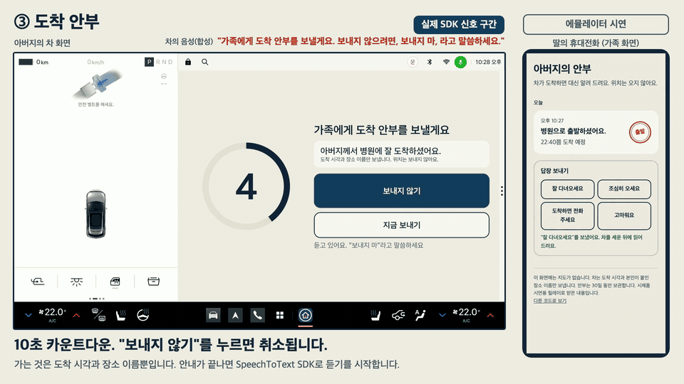

# 안부

부모님 차가 도착하면 가족에게 "잘 도착했어요"를 대신 전하는 Pleos Connect 차량용 앱입니다.



- 웹 시연(브라우저에서 눌러 보기): https://taronsung.github.io/anbu/
- 저장소: https://github.com/taronsung/anbu
- APK 내려받기: https://github.com/taronsung/anbu/releases/latest

현대자동차그룹 차량용 앱 개발 공모전(Code your App into Pleos App Market) 출품작의 시제품입니다.

## 1. 앱 이름과 한 줄 소개

**안부**. 집, 병원처럼 이름을 붙인 곳에 차가 서면(저장한 장소 진입과 기어 P) 10초 동안 알린 뒤 가족에게 도착 시각과 장소 이름만 전합니다.
가족은 정해 둔 답장 가운데 하나를 눌러 보낼 수 있고, 차는 서 있을 때만 그 답장을 읽어 줍니다.
실시간 위치 추적이 없고, 계정 주인은 운전자 본인입니다.

## 2. 실행 방법

### APK 설치

```
adb install -r -d apk/*_안부_release.apk
adb shell am start --user 10 -n app.anbu.car/.MainActivity
```

Pleos Connect Emulator는 운전자 사용자가 10번입니다. 앱 데이터를 지울 때도
`adb shell pm clear --user 10 app.anbu.car`처럼 사용자를 지정합니다.

첫 실행 동의 화면의 선택 항목 세 개는 꺼진 채로 나옵니다. 도착 안부를 보려면 "도착·출발 안부 보내기"와 "저장한 장소 도착 알아채기"를,
괜찮으세요를 보려면 "괜찮으세요 확인"을 켜고 동의합니다. 나중에 공유 설정에서도 켤 수 있습니다.

### 가족 화면(시연용 릴레이) 실행

```
node relay/server.js
```

브라우저에서 `http://127.0.0.1:8787/`을 열고, 차 화면에 나온 가족 초대 코드 여섯 자리를 넣습니다.
안부가 한 건이라도 오면 그 아래에 "답장 보내기" 단추 네 개가 나옵니다. 누르면 3초 안에 차가 받아, 기어가 P일 때 읽어 줍니다.
에뮬레이터 안의 앱은 기본값으로 `http://10.0.2.2:8787`(개발 PC)에 보냅니다. 주소를 바꾸려면 앱을 이렇게 띄웁니다.

```
adb shell am start --user 10 -n app.anbu.car/.MainActivity --es relay_url http://192.168.0.10:8787
```

### 차량 신호 넣기

Pleos Connect Virtual Console을 씁니다.

```
adb forward tcp:8088 tcp:8088
```

브라우저에서 `http://127.0.0.1:8088/`을 열어 직접 조작하거나, 같은 조작을 터미널에서 되풀이하는 `tools/vc.mjs`를 씁니다.
아래 한 줄이 "출발, 주행, 급감속, 주차"입니다.

```
node tools/vc.mjs gear:Drive ramp:0:50:5 wait:20 brake:100 ramp:50:8:1 brake:0 ramp:8:40:3 wait:15 ramp:40:0:4 gear:Park
```

주행 중에 `adb emu geo fix 126.9990 37.5796`(시연용 "병원" 좌표)을 넣고 P에 두면 20초 뒤 도착 안부 카운트다운이 뜹니다.
좌표를 넣지 않으면 이름 없는 곳에 선 것이므로 주행만 기록하고 알리지 않습니다(공유 설정의 "이름 없는 곳도 알리기"를 켜면 "외출지"로 알립니다).

### 차량 신호 없이 흐름만 보기

앱의 설정 > 연결 상태와 시연에 있는 "병원 가는 길 재생", "급정지 상황 재생", "예시 기록 넣기"를 씁니다.
정해 둔 대본과 예시 기록을 쓰는 단추이며, 그동안 화면에 "시뮬레이션"과 "예시 기록 포함" 표시가 붙습니다.

### 웹 시연

`webdemo/index.html`을 브라우저로 열면 차 화면과 가족 휴대전화를 한 화면에서 눌러 볼 수 있습니다.
설치할 것이 없고, 같은 페이지가 https://taronsung.github.io/anbu/ 에 있습니다.

### 소스에서 빌드

```
./gradlew :app:testDebugUnitTest      # JVM 단위 테스트
./gradlew :app:assembleRelease        # 서명된 release APK
```

release 서명에는 `signing/signing.properties`와 키 저장소가 필요합니다. 이 폴더는 저장소에 올리지 않습니다.
새 키를 만드는 방법은 다음과 같습니다.

```
mkdir signing
keytool -genkeypair -keystore signing/anbu-release.jks -storetype PKCS12 -alias anbu \
  -keyalg RSA -keysize 4096 -validity 10000 -dname "CN=anbu-dev"
# signing/signing.properties
#   storeFile=signing/anbu-release.jks
#   storePassword=...
#   keyAlias=anbu
#   keyPassword=...
```

## 3. 테스트 환경과 필요한 설정

| 항목 | 값 |
|---|---|
| 개발 PC | Apple Silicon Mac, Android Emulator 37.2.13 |
| JDK / Gradle / AGP / Kotlin | 17 / 8.9 / 8.7.3 / 2.0.21 |
| compileSdk / targetSdk / minSdk | 34 / 34 / 28 |
| 화면 | Jetpack Compose (BOM 2024.09.03) |
| Node.js | 릴레이와 `tools/vc.mjs`에 18 이상 |
| Pleos SDK | Vehicle 2.3.2, NaviHelper 3.0.5, FusedLocation 1.1.3, TextToSpeech 3.3.1, SpeechToText 3.3.1 |

필요한 설정은 세 가지입니다.

1. 네트워크: 에뮬레이터를 처음 켜면 네트워크가 꺼져 있습니다. 차량 설정 > 연결 > Wi-Fi에서 `AndroidWifi`를 눌러 연결합니다.
   이 연결이 있어야 가족 화면으로 안부가 가고 내비게이션 앱의 경로 탐색이 됩니다.
2. 허용 창: 앱이 처음 실행될 때 두 가지를 묻습니다.
   - `android.car.permission.CAR_SPEED`(차 속도). 시스템 창에는 "위치 정보"라고 나옵니다.
     자동차용 안드로이드가 속도를 위치 권한 묶음에 넣어 두었기 때문이며, 앱은 그 창을 띄우기 전에 이 점을 설명합니다.
   - `pleos.car.permission.FUSED_LOCATION`. 저장한 장소 도착 판정을 켠 경우에만 묻습니다.
     에뮬레이터 v2.1.0의 시스템 창에는 "알 수 없는 작업"이라고 나옵니다.

   둘 다 허용하지 않아도 앱은 동작합니다. 속도가 없으면 급감속 항목이 빠지고,
   위치가 없으면 내비게이션으로 안내받아 도착한 곳만 알립니다.
3. 평문 통신: 시연용 릴레이는 개발 PC에서 도는 `http` 서버입니다. 앱은 `http`를 `10.0.2.2`, `127.0.0.1`, `localhost`에만 허용하고
   그 밖의 주소에는 TLS를 요구합니다(`app/src/main/res/xml/network_security_config.xml`).

## 4. 에뮬레이터 버전과 화면 규격

| 항목 | 값 |
|---|---|
| 에뮬레이터 | Pleos Connect Emulator v2.1.0 |
| 시스템 이미지 | `system-images;android-34;pleos_car_emulator;arm64-v8a` (Android 14, API 34) |
| 디스플레이 | 2560x1440, 160dpi(1px = 1dp), 가로형. Pleos 문서의 화면 규격 표에서 Connect-S-17과 같은 값 |
| 앱 창(가로) | 1682x1210dp. 에뮬레이터에서 잰 값(`dumpsys activity`의 창 경계 853,90 ~ 2535,1300). 문서의 규격 표는 1700x1184dp |
| 앱 창(세로) | 841x1210dp. 창 손잡이를 끌어 다른 앱과 2분할했을 때 에뮬레이터에서 잰 값(창 경계 853,90 ~ 1694,1300). 문서의 규격 표는 840x1184dp |
| AVD | Automotive, RAM 4GB, cold boot. `-no-window -gpu host -no-audio`로 창과 소리 없이 실행 |

앱은 가로 창과 세로 창 모두에 맞춰 배치를 바꿉니다. 창 크기가 바뀌어도 화면을 다시 만들지 않습니다.
본문 글자는 30sp, 보조 설명 글자는 24sp, 주요 단추의 높이는 96dp 이상입니다.

## 5. APK 위치

- 저장소: [`apk/`](apk/) 폴더의 `팀명_안부_release.apk`(공모전 규격 `팀명_앱이름_release.apk`)
- Release: https://github.com/taronsung/anbu/releases/latest

패키지 이름은 `app.anbu.car`, 버전은 0.2.0입니다. APK Signature Scheme v3로 서명한 release 빌드입니다.

---

## 기능 여섯 가지

1. **도착 안부.** 주행한 뒤 기어를 P에 두고 20초가 지나면 도착으로 봅니다. 그곳이 운전자가 이름을 붙여 저장한 곳이면
   (저장한 장소의 반경 150m에 들어섰거나, 앱에서 길안내를 요청한 저장 장소에 내비게이션이 도착을 알림)
   차가 10초 동안 화면과 음성으로 "가족에게 도착 안부를 보낼게요"라고 알리고,
   그동안 "보내지 않기"를 누르거나 "보내지 마"라고 하면 보내지 않습니다.
   가족이 받는 것은 "아버지께서 병원에 잘 도착하셨어요" 한 줄과 시각입니다.
   가족에게 가는 장소 이름은 운전자가 붙인 이름(집, 병원, 딸네, 마트)뿐입니다.
   주유소나 편의점, 저장하지 않은 내비게이션 목적지처럼 이름 없는 곳에 선 것은 주행만 기록하고 알리지 않습니다.
   공유 설정의 "이름 없는 곳도 알리기"(기본 꺼짐)를 켠 경우에만 "외출지에 잘 도착하셨어요"로 알립니다.
   0.3km 미만이고 움직인 시간이 1분 미만인 이동은 도착으로 치지 않습니다.
   보내지 못한 안부는 5초에서 10분까지 간격을 늘려 다시 보내고, 24시간이 지나면 버립니다.
2. **출발 한마디.** "가족에게 한마디"를 누르거나 "말로 하기"를 누른 뒤 "출발한다고 전해 줘"라고 하면
   "지금 병원으로 출발하셨어요. 22:10쯤 도착 예정"이 갑니다. 도착 예정 시각은 내비게이션이 알려 준 소요 시간에서 계산합니다.
3. **가족의 답장.** 가족 화면에는 "잘 다녀오세요", "조심히 오세요", "도착하면 전화 주세요", "고마워요" 단추 네 개가 있습니다.
   하나를 누르면 차로 가고, 차는 기어가 P이고 주행이 끝난 뒤에만 음성으로 읽어 준 다음 홈에 카드로 남깁니다.
   주행 중에 온 답장은 읽지 않고 두었다가 도착 안부 안내가 끝난 뒤에 읽습니다. 가족이 글을 써서 보내는 길은 없습니다.
4. **주간 운전 일기.** 주행이 끝날 때마다 요약을 차 안에 남기고, 최근 7일을 지난 8주의 본인 기록과 견줘
   "평소와 비슷", "조금 다름", "많이 다름" 가운데 하나로 말합니다. 화면의 행은 여덟 개입니다: 운전한 횟수, 운전한 거리, 밤 운전,
   비 오는 날 운전, 급하게 멈춤, 안전띠 늦게 맴, 길 다시 찾음, 보호구역·역주행 주의.
   일기는 차 화면에 먼저 뜨고, 본인이 "가족과 나누기"를 눌러야 갑니다.
   본인 기록과의 비교이고 건강이나 운전 능력을 판정하지 않습니다. 지난 기록이 4주보다 적으면 비교하지 않고 "기준을 만드는 중"이라고 말합니다.
5. **괜찮으세요.** 급하게 멈춘 뒤 기어가 P가 아닌 채(D, R, N) 60초 동안 서 있거나 에어백 작동 신호가 오면 차가 "괜찮으세요?" 하고 묻습니다.
   "괜찮아요"를 누르거나 "괜찮아"라고 답하면 끝이고, 30초 동안 답이 없으면 가족에게 시각을 알립니다. 119에 자동으로 신고하지 않습니다.
   화면의 "119 전화" 단추는 전화 앱을 119가 입력된 채로 엽니다. 전화를 대신 걸지는 않습니다.
   가족 화면의 알림 아래에는 119 신고와 위치정보법 제29조 제1항(배우자와 2촌 이내 친족의 긴급구조 위치 확인 요청) 안내가 붙습니다.
6. **자주 가는 곳.** 홈의 큰 단추 네 개(집, 병원, 딸네, 마트)를 누르면 Pleos 내비게이션이 그곳으로 안내를 시작합니다.

무엇을 나눌지는 운전자 본인이 정합니다. 첫 실행 동의 화면의 선택 항목은 꺼진 채로 나오고 본인이 켠 것만 동의로 받으며, 그 뒤에는 공유 설정에서 켜고 끕니다.

- "오늘은 쉬기": 자정까지 기록, 전송, 답장 받기를 멈춥니다.
- "이번 운전만 쉬기": 다른 사람이 운전할 때 누릅니다. 그 주행은 기록하지도 보내지도 않고 운전 일기의 기준에도 넣지 않습니다. 주행이 끝나 P에 두고 20초가 지나면 저절로 풀립니다.
- "모두 지우기": 차 안의 기록과 암호화 키, 가족 초대 코드, 릴레이에 남은 안부를 지웁니다.

## 기존 서비스와 다른 점

블루링크에는 '내 차 위치 공유'와 '내 차 위치 자동 전송'이 있습니다. 내비게이션 목적지를 설정하면 지정한 사람에게
차량 위치를 볼 수 있는 주소를 문자로 보내고, 주행 중 위치와 목적지, 남은 시간을 공유합니다.

| | 블루링크 내 차 위치 공유 | 안부 |
|---|---|---|
| 시작 | 내비게이션 목적지를 설정할 때 자동 전송 | 저장한 장소 진입과 기어 P. 목적지를 설정하지 않아도 됨 |
| 가족이 보는 것 | 주행 중 차량 위치, 목적지, 남은 시간 | 도착한 사실 한 줄과 시각, 본인이 붙인 장소 이름. 위치는 없음 |
| 가족의 응답 | | 정해 둔 답장 네 가지. 차가 서 있을 때 읽어 줌 |

## 차량 신호가 만드는 순간

| 순간 | 차량 신호 | SDK·API | 기능 |
|---|---|---|---|
| 차를 세웠다 | 기어 P, 속도 0 | AAOS Car API `GEAR_SELECTION`, `PERF_VEHICLE_SPEED` | 도착 안부의 시작(P 20초), 답장을 읽어도 되는 때 |
| 저장한 장소에 들어섰다 | 근접 알림 ENTER | FusedLocation `addProximityAlert` | 도착 안부를 보낼지와 장소 이름("병원") |
| 길안내를 시작했다 | 소요 시간, 거리 | NaviHelper `requestRoute`, `onRouteStarted` | 자주 가는 곳, 출발 한마디의 도착 예정 시각 |
| 목적지에 도착했다 | 도착 이벤트 | NaviHelper `onDestinationArrived` | 도착 안부를 보낼지와 장소 이름 |
| 주행 중이다 | 기어 D, 주행 규제 | AAOS Car API, `CarUxRestrictionsManager` | 주행 중 화면을 글 두 줄과 큰 단추 둘로 줄임. 답장을 읽지 않음 |
| 급하게 멈췄다 | 브레이크 페달, 속도 변화 | Vehicle `Brake.registerBrakePedalStatus`, AAOS 속도 | 일기의 "급하게 멈춤", 괜찮으세요 |
| 비가 온다, 밤이다 | 와이퍼, 전조등 | Vehicle `Wiper.registerWiperState`, `Light.registerLowBeamLightState` | 일기의 비 오는 날 운전, 밤 운전 비율 |
| 안전띠를 늦게 맸다 | 안전띠 체결, 경고 | Vehicle `Seat.registerSeatBeltBuckledState`, `Safety.registerSeatBeltNotBuckledWarning` | 일기의 "안전띠 늦게 맴" |
| 얼마나 달렸다 | 누적 주행거리 | Vehicle `Odometer.registerDistanceDriven` | 일기의 거리 |
| 길을 다시 찾았다, 주의 구간이다 | 재탐색, 주의 지점 | NaviHelper `onReRouteEnded`, `onCautionPointInfo` | 일기의 "길 다시 찾음", "보호구역·역주행 주의" |
| 에어백이 작동했다 | 에어백 작동 | Vehicle `Safety.registerSeatAirbagDeployed` | 괜찮으세요 |
| 차가 말한다 | | TextToSpeech `speak`(ON_DEVICE) | 도착 안부 안내, 답장 읽어 주기, 괜찮으세요, 일기 읽어 주기 |
| 운전자가 말한다 | | SpeechToText `request`(ON_DEVICE) | "말로 하기" 단추, "보내지 마", "지금 보내", "괜찮아" |

기어와 속도는 문서 안내대로 AAOS Car API에서 받습니다. Vehicle SDK의 각 도메인은 `checkXxxCapabilities`로 지원 여부를 확인한 뒤 등록합니다.

### 선언한 권한

기능에 쓰는 신호의 읽기 권한만 선언했습니다. 차량 제어 권한은 없습니다.

| 권한 | 쓰는 곳 |
|---|---|
| `pleos.car.permission.CAR_DRIVE` | 브레이크 페달, 누적 주행거리 |
| `pleos.car.permission.CAR_LIGHTS` | 전조등(밤 운전 비율) |
| `pleos.car.permission.CAR_SAFETY` | 에어백 작동, 안전띠 경고 |
| `pleos.car.permission.CAR_SEATS` | 안전띠 체결 |
| `pleos.car.permission.CAR_WINDOWS` | 와이퍼(비 오는 날 운전 비율). 와이퍼 API가 요구하는 권한이라 필요 |
| `pleos.car.permission.NAVI_ROUTE_SEARCH`, `NAVI_ROUTE` | 길안내 요청, 안내 이벤트 |
| `pleos.car.permission.FUSED_LOCATION` | 저장한 장소 근접 알림, "지금 있는 곳으로" 저장. 실행 중에 허용을 받음 |
| `pleos.car.permission.TTS_SERVICE`, `STT_SERVICE` | 음성 안내, 듣기 |
| `android.car.permission.CAR_POWERTRAIN` | 기어 |
| `android.car.permission.CAR_SPEED` | 속도. 실행 중에 허용을 받음 |
| `android.permission.INTERNET` | 릴레이로 안부를 보내고 답장을 받음 |

### 음성

- 듣기는 SpeechToText SDK입니다. 듣기가 켜지는 곳은 세 군데입니다.
  홈과 주행 화면의 "말로 하기" 단추를 누른 뒤 6초("출발한다고 전해 줘", "도착했다고 전해 줘", "운전 일기 읽어 줘"),
  도착 안부 안내가 끝난 뒤 7초("보내지 마", "지금 보내"), 괜찮으세요 물음이 끝난 뒤 20초("괜찮아").
  듣는 동안에는 단추와 화면의 글이 바뀌고 시스템 상태 표시줄에 마이크 표시가 뜹니다.
- 인식된 문장에서 명령을 고르는 부분은 `voice/VoiceCommand.kt`이고 단위 테스트로 확인했습니다.
  에뮬레이터에서는 마이크 입력을 주지 않아 인식 결과를 확인하지 못했습니다. 같은 동작을 모두 화면 단추로 할 수 있습니다.
- Gleo AI 연결은 입점 단계의 계획입니다. 그때 쓰도록 `app/src/main/assets/schema.json`에 액션 세 개
  (`SEND_DEPARTURE_NOTE`, `SEND_ARRIVAL_NOTE`, `READ_WEEKLY_DIARY`)의 형식을 적어 두었고, 같은 이름의 인텐트를 받아 처리하는 코드를 넣어 두었습니다.
  이 인텐트는 adb로 보내 처리되는 것을 확인했습니다.

  ```
  adb shell am start --user 10 -a SEND_DEPARTURE_NOTE -n app.anbu.car/.MainActivity
  adb shell am start --user 10 -a READ_WEEKLY_DIARY -n app.anbu.car/.MainActivity
  ```

## Pleos 문서의 요건과 이 시제품

| 문서의 요건 | 이 시제품 |
|---|---|
| 주행 중에 쓰려면 Distraction Optimization(DO)을 선언하고, 주행 규제가 걸리면 CarUxRestrictions에 맞춰 UX를 제한한다 | 액티비티에 `distractionOptimized` 메타데이터를 선언. `CarUxRestrictionsManager`가 주행 규제를 알리거나 기어가 D, R, N이면 주행 화면으로 바꿈. 주행 화면은 목적지 한 줄, 도착 예정 한 줄, 큰 단추 둘이고 글 입력과 목록, 움직이는 요소가 없음. 일기와 설정은 주행 중에 열리지 않음 |
| 주행 중 CPU 5% 미만(내비게이션이 아닌 앱), RAM 400MB 이하 | 에뮬레이터의 주행 화면에서 잰 값: PSS 약 55MB(RSS 약 180MB), `top`의 CPU 0~1% |
| 외부 통신은 암호화된 프로토콜(TLS 1.2 이상) | 시연용 릴레이는 개발 PC의 평문 `http`이고, 앱은 그 주소(`10.0.2.2`, `127.0.0.1`, `localhost`)에만 평문을 허용. 실제 서버는 TLS로 바꿔야 함 |
| 기기에 저장하는 민감정보는 암호화하고 키는 Android Keystore로 보호 | 주행 요약, 동의 상태, 장소 좌표, 보낼 안부, 받은 답장을 Keystore 키의 AES-256-GCM으로 암호화 |
| 차량 소유자 변경, 운전자 교체 때 쉽게 로그아웃하고 계정을 바꿀 수 있어야 한다 | "이번 운전만 쉬기"(다른 사람이 운전하는 한 번), "오늘은 쉬기"(자정까지), 공유 설정의 항목별 끄기, "모두 지우기"(기록, 키, 가족 초대 코드 삭제. 다시 동의하면 새 코드). 가족 연결만 끊는 전용 단추는 없음 |
| Vehicle SDK 권한은 입점 때 사전 협의와 승인 | 위 표의 읽기 권한 다섯 개가 그 대상 |

앱 데이터는 안드로이드 사용자 단위 저장소에 있습니다. 에뮬레이터에서 앱은 운전자 사용자(10번)로 실행됩니다.
지금 누가 운전하는지 알려 주는 API는 공모전에서 쓸 수 있는 SDK에 없어서, 다른 사람이 몰 때는 "이번 운전만 쉬기"를 누르거나 10초 안내의 "보내지 않기"로 막습니다.

## 무엇을 어떻게 확인했나

2026-11-11에 Pleos Connect Emulator v2.1.0에서 확인한 결과입니다.

### 에뮬레이터에서 실제 SDK 호출과 신호로 확인한 것

| 항목 | 확인 방법 | 결과 |
|---|---|---|
| Vehicle SDK 브레이크, 주행거리, 와이퍼, 전조등 | Virtual Console에서 값을 바꾸고 앱의 연결 상태 화면과 주행 요약 확인 | 값이 바뀌는 대로 앱에 반영됨 |
| AAOS 기어, 속도 | Virtual Console의 Gear, 속도 조작 | 주행 화면 전환, 주행 구간 기록, 급감속 감지 |
| 주행 규제(CarUxRestrictions)와 DO 선언 | D로 바꾸고 속도를 올림 | 앱이 주행 중에도 표시되고 주행 화면으로 바뀜 |
| NaviHelper `requestRoute` | 홈의 "병원" 단추 | Pleos 내비게이션이 경로를 찾고 안내를 시작함 |
| NaviHelper `onRouteStarted` | 위와 같음 | 소요 시간과 거리 수신. 도착 예정 시각 표시와 출발 한마디에 사용 |
| FusedLocation `addProximityAlert` | `adb emu geo fix`로 저장한 장소 좌표를 넣음 | ENTER 수신. "병원" 도착으로 카운트다운이 시작됨 |
| FusedLocation `getLastKnownLocation` | 자주 가는 곳 위치 화면의 "지금 있는 곳으로" | 위치를 읽어 저장하고 장소 알림을 다시 등록함 |
| 이름 없는 곳에 세움 | 장소 좌표를 넣지 않고 주행한 뒤 P | 주행은 기록되고 카운트다운이 뜨지 않음. 릴레이에 아무것도 가지 않음 |
| 도착 안부 취소 | 카운트다운 중 "보내지 않기" | "보내지 않았어요" 안내가 나오고 릴레이에 아무것도 가지 않음 |
| 이번 운전만 쉬기 | 누른 뒤 저장한 장소까지 주행하고 P | 그 주행은 기록되지 않고 릴레이에 아무것도 가지 않음. P에 두고 20초 뒤 "쉬었던 운전이 끝났어요" 안내와 함께 저절로 풀림 |
| 내비게이션과 2분할로 나란히 둔 상태 | 창을 2분할로 두고 주행, 좌표 주입, P | 주행 화면, 카운트다운, 전송까지 전체 창과 같이 동작 |
| 다른 앱을 앞에 둔 상태 | 안부가 있던 칸에 내비게이션을 띄우고 주행, 좌표 주입, P | 전송되지 않음. 약 10초 뒤 시스템이 앱 프로세스를 얼리고(`ActivityManager`의 freezing 기록) 그 주행은 기록되지 않음. 앱을 다시 열어도 뒤늦게 가지 않음 |
| 앱이 꺼진 상태 | 앱을 강제 종료하고 주행, 좌표 주입, P | 전송되지 않음 |
| 괜찮으세요 알림의 "병원을 떠난 뒤" | 설정을 켜고 병원 도착 뒤 "급정지 상황 재생" | 가족 화면의 알림에 "병원을 떠난 뒤"가 붙음(대본 재생) |
| TextToSpeech `speak`(ON_DEVICE) | 안내가 나올 때의 SDK 이벤트 기록 | onStart, onDone 수신. 소리 없이 띄운 에뮬레이터라 소리는 듣지 못함 |
| SpeechToText `request`(ON_DEVICE) | "말로 하기" 단추(홈, 주행 화면), 카운트다운, 괜찮으세요 | onReady 수신, 화면이 "듣는 중"으로 바뀌고 상태 표시줄에 마이크 표시. 마이크 입력을 주지 않아 인식 결과는 확인하지 못함 |
| 출발 한마디, 도착 안부, 주간 일기 전송 | 릴레이 기록과 가족 화면 | 전송되고 가족 화면에 표시됨 |
| 가족의 답장(차가 서 있을 때) | 가족 화면의 "고마워요" 단추, 같은 요청의 curl | 3초 안에 차가 받아 TextToSpeech onStart, 홈에 답장 카드 |
| 가족의 답장(주행 중) | 시속 40km로 달리는 중에 답장을 보냄 | 주행 중에는 읽지 않음. P에 두고 도착 안부를 보낸 5초 뒤에 읽음 |
| 정해 둔 답장이 아닌 요청 | 글을 넣은 요청을 릴레이에 보냄 | 릴레이가 거절(422) |
| 가로 창, 세로 창 | 창 손잡이를 끌어 2분할로 바꿈 | 다시 만들지 않고 배치만 바뀜 |

### 에뮬레이터에서 확인하지 못해 단위 테스트와 대본으로 검증한 것

| 항목 | 이유 | 검증 |
|---|---|---|
| 안전띠 체결 변화 | Virtual Console v2.1.0에 안전띠 체결 카드가 없음 | `TripRecorderTest` |
| 안전띠 경고, 에어백 작동 | 에뮬레이터가 `ERROR_NOT_SUPPORTED_PROPERTY`를 돌려줌. 앱은 "이 차에서 받지 못하는 신호"로 표시하고 나머지를 계속 씀 | `TripRecorderTest`, `EngineFlowTest` |
| NaviHelper `onDestinationArrived`, `onCautionPointInfo`, `onReRouteEnded`, `onTripInfo` | 에뮬레이터에서는 차가 경로를 따라 움직이지 않아 이벤트가 오지 않음. 도착 이름은 FusedLocation으로 확인 | `EngineFlowTest`, 대본 재생 |
| 음성 인식 결과 | 마이크 입력을 주지 않음 | `EngineFlowTest`의 명령 해석, 같은 동작의 화면 단추 |
| 괜찮으세요 | 에어백 신호는 에뮬레이터가 지원하지 않음. 급감속 뒤 정지 경로는 대본으로 확인 | 앱의 "급정지 상황 재생" 대본, `EngineFlowTest` |
| 주간 일기의 8주 비교 | 8주의 실제 주행 기록이 없음 | 앱의 "예시 기록 넣기", `BaselineTest` |
| 전송 재시도와 24시간 뒤 폐기 | 통신을 끊고 기다리는 시험을 하지 않음 | `EngineFlowTest` |

### 시연용인 것

- 설정의 "병원 가는 길 재생", "급정지 상황 재생"은 정해 둔 대본(`signals/SimulatedSource.kt`)입니다.
  실제의 4배 속도로 재생하며 화면에 "시뮬레이션" 표시가 붙습니다.
- "예시 기록 넣기"는 지난 8주와 최근 7일의 주행 요약 45건을 만들어 넣습니다(`core/ExampleHistory.kt`).
  실제 주행 기록이 아니며 일기 화면에 "예시 기록 포함" 표시가 붙습니다.
- 자주 가는 곳 네 군데의 처음 좌표는 공공장소 근처의 시연용 값입니다.
- 릴레이와 가족 화면은 시연용입니다. 인증과 TLS가 없습니다. 차는 답장을 3초마다 릴레이에 물어서 받습니다.
- 가족 화면은 초대 코드를 넣고 여는 웹 페이지입니다. "알림 켜기"를 누르면 그 화면이 열려 있는 동안(다른 탭에 있어도) 새 안부가 올 때 브라우저 알림을 띄웁니다.
  서버가 밀어 보내는 알림이 아니어서 화면을 닫으면 오지 않습니다. 알림은 `https`나 `localhost`로 연 경우에만 켤 수 있습니다.
- 안부가 화면의 한 칸에 떠 있는 동안에만 신호를 받아 기록합니다(전체 창, 다른 앱과 2분할). 다른 앱을 그 칸의 앞에 두면 안드로이드가 앱 프로세스를 얼려서 그 주행은 기록되지 않고 안부도 가지 않습니다. 시동 뒤에 앱을 열지 않은 경우도 같습니다.
- 웹 시연(`webdemo/`)은 앱의 동작을 브라우저에서 재현한 것입니다. 문구와 색, 글자 크기는 앱과 같고 차량 신호는 단추로 대신합니다.

## 개인정보 설계

### 차 밖으로 나가는 항목

가족에게 보내는 안부 한 건의 항목은 아래 열두 개가 전부입니다(`anbu/AnbuNote.kt`의 `WIRE_KEYS`).
좌표, 경로, 속도는 항목 자체가 없습니다.

| 항목 | 내용 | 예 |
|---|---|---|
| `v` | 형식 버전 | 1 |
| `id` | 안부 한 건의 식별자 | |
| `familyCode` | 가족 초대 코드 | 여섯 자리 |
| `type` | 종류 | 출발, 도착, 주간 일기, 괜찮으세요 |
| `who` | 운전자 호칭. 이름이 아님 | 아버지 |
| `at` | 시각(분 단위) | 2026-11-11T21:41+09:00 |
| `line` | 가족이 읽는 한 줄 | 아버지께서 병원에 잘 도착하셨어요. |
| `placeLabel` | 본인이 붙인 장소 이름. 괜찮으세요 알림에서는 떠나온 곳. "이름 없는 곳도 알리기"를 켠 경우의 이름 없는 곳은 "외출지" | 병원, 병원을 떠난 뒤 |
| `etaText` | 도착 예정 문구 | 22:10쯤 도착 예정 |
| `durationNote` | 평소보다 오래 걸렸다는 한 줄. 본인이 켠 경우만 | 평소보다 10분쯤 더 걸렸어요 |
| `level` | 주간 일기의 단계 | 조금 다름 |
| `details` | 주간 일기의 수치. 본인이 켠 경우만 | 주행 5번, 거리 55km |

릴레이도 같은 목록으로 검사합니다. 목록에 없는 항목이나 좌표, 속도로 보이는 값이 오면 저장하지 않고 거절합니다.

### 차 밖에서 들어오는 항목

가족의 답장 한 건에서 차가 받는 항목은 세 개가 전부입니다(`anbu/FamilyReply.kt`의 `WIRE_KEYS`).

| 항목 | 내용 | 예 |
|---|---|---|
| `id` | 릴레이가 붙인 식별자 | |
| `code` | 정해 둔 답장 네 가지의 이름 | `SAFE_TRIP` |
| `atMs` | 릴레이가 받은 시각 | |

- 답장의 문장은 오지 않습니다. 차가 이름에 맞는 문장을 앱 안에서 고릅니다. 네 가지 이름이 아니거나 다른 항목이 붙은 답장은 릴레이와 차가 모두 버립니다.
- 세 시간이 지난 답장은 받지 않습니다. 받은 답장은 스무 건까지 차 안에 암호화해 두고, "모두 지우기"나 "가족의 답장 받기"를 끄면 지웁니다.
- 동의하지 않았거나 쉬는 중이거나 "가족의 답장 받기"를 끈 동안에는 릴레이에 묻지도 않습니다.

### 어디에 얼마나 두나

| 무엇 | 어디에 | 얼마나 |
|---|---|---|
| 초 단위 신호(속도 변화, 제동 시점) | 메모리에서만 처리 | 주행이 끝나면 요약만 남기고 버림 |
| 주행 요약(거리, 비율, 횟수, 도착 장소 id) | 차 안, Android Keystore 키로 AES-256-GCM 암호화 | 9주(기준 8주와 최근 1주) 뒤 자동 삭제 |
| 저장한 장소의 좌표 | 차 안, 같은 암호화 저장소 | 본인이 지울 때까지. 차 밖으로 나가지 않음 |
| 안부(위 열두 항목) | 릴레이와 가족 화면 | 30일 |
| 가족의 답장(위 세 항목) | 릴레이 | 24시간. 차에는 세 시간 안의 것만 내줌 |

- 동의하지 않을 수 있습니다. 그 경우 기록과 전송은 하지 않고 자주 가는 곳 길안내만 씁니다.
- 주간 일기는 본인이 "가족과 나누기"를 눌렀을 때만 갑니다. 기본은 단계와 한 줄이고, 수치는 본인이 켠 경우에만 붙습니다.
- "괜찮으세요" 알림에는 시각만 갑니다. 본인이 미리 켜 둔 경우 떠나온 곳의 이름을 "병원을 떠난 뒤"처럼 붙입니다. 지금 있는 곳이 아니라 떠나온 곳입니다.
- 주행 기록을 광고나 마케팅에 쓰지 않고 제3자에게 주지 않습니다.
- 백업과 기기 간 이전에서 앱 데이터를 제외했습니다(`data_extraction_rules.xml`).

### 위치정보법 조항과 앱의 대응

위치정보의 보호 및 이용 등에 관한 법률(법률 제21066호, 2025-10-01 시행)에서 이 앱은 위치기반서비스사업자의 자리에 있습니다.
그 조항과, 이 시제품에 들어 있는 대응입니다.

| 조항 | 내용 | 앱의 대응 |
|---|---|---|
| 제15조 제1항 | 누구든지 개인위치정보주체의 동의 없이 개인위치정보를 수집, 이용, 제공해서는 안 된다 | 동의 전에는 기록도 전송도 하지 않음(`ConsentGateTest`). 동의하지 않고 길안내만 쓸 수 있음 |
| 제19조 제1항 | 개인위치정보를 이용해 서비스를 제공하려면 미리 내용을 알리고 동의를 받는다 | 첫 실행 동의 화면이 항목마다 쓰는 정보, 쓰는 이유, 보관 기간, 거부할 수 있다는 점을 보여 줌. 선택 항목(안부 보내기, 저장한 장소 도착 알아채기, 괜찮으세요 확인)은 꺼진 채로 나오고 본인이 켠 것만 동의로 받음 |
| 제19조 제2항 | 지정한 제3자에게 제공하려면 제공받는 자와 제공 목적을 알리고 동의를 받는다 | 받는 사람은 운전자가 초대 코드를 건넨 가족뿐. 동의 화면에서 가족에게 가는 내용과 보일 호칭을 보여 줌. 공유 설정에서 항목별로 켜고 끔 |
| 제19조 제3항 | 제공할 때마다 제공받는 자, 제공 일시, 제공 목적을 즉시 알린다 | 도착 안부를 보내기 전에 10초 동안 화면과 음성으로 알리고, 보낸 뒤 홈에 "전함" 도장과 시각을 남김. 출발 한마디와 일기 나누기는 본인이 누른 직후 음성과 화면으로 알림 |
| 제24조 제1항, 제2항 | 동의는 언제든 철회할 수 있고 일시 중지를 요구할 수 있다 | "오늘은 쉬기"(자정까지 기록과 전송 중지), "이번 운전만 쉬기", 공유 설정의 항목별 끄기, "모두 지우기"(암호화 키 삭제와 릴레이 삭제 요청) |
| 제26조 제1항 | 보호의무자의 동의로 갈음할 수 있는 대상은 8세 이하 아동, 피성년후견인, 중증 정신장애인이다. 고령은 대상이 아니다 | 동의와 설정은 차 화면에서 운전자 본인이 함. 가족 화면에는 설정을 바꾸는 기능이 없음 |

제19조 제4항의 모아서 통보하는 방식은 넣지 않았습니다. 위치기반서비스사업 신고(제9조)는 출시 단계의 일입니다.

## 테스트

`./gradlew :app:testDebugUnitTest`로 JVM 단위 테스트 81건을 돌립니다.
판단 로직(`core`, `trip`, `baseline`, `anbu`, `privacy`)은 안드로이드에 의존하지 않는 코틀린이라 JVM에서 검증합니다.

| 파일 | 건수 | 보는 것 |
|---|---|---|
| `TripRecorderTest` | 11 | 주행 구간, 거리, 밤과 비 비율, 급감속, 안전띠, P 20초, 짧은 이동 버리기 |
| `BaselineTest` | 10 | 중앙값과 MAD, 세 단계 경계, 튀는 주의 영향, 7일 구간, 예시 기록의 판정 |
| `ConsentGateTest` | 18 | 동의 없이는 저장도 전송도 없음, 이름 없는 곳은 기본으로 알리지 않음, 오늘은 쉬기, 이번 운전만 쉬기, 주행 중 쉬기, 전체 삭제, 재시작 뒤 복원, 보관 기간 |
| `NoteComposerTest` | 9 | 안부 문장, 조사, 도착 예정 시각, 차 밖으로 나가는 항목, 금지 표현 |
| `EngineFlowTest` | 22 | 출발 한마디, 10초 취소, 주간 일기 나누기, 괜찮으세요와 "떠난 뒤" 표기, 전송 재시도, 음성 명령 해석, 대본 재생 |
| `ReplyTest` | 11 | 정해 둔 답장만 받음, 기어 P에서만 읽음, 주행 중과 다른 안내 중에는 미룸, 쉬는 중과 끈 경우, 오래된 답장, 재시작과 삭제 |

`node --test relay/`로 릴레이 점검 4건을 돌립니다(안부 항목 검사, 좌표와 속도 거절, 답장 네 가지만 받기, 답장 내주기).

웹 시연은 Playwright Chromium으로 장면 네 개와 답장, 듣기 단추, 이번 운전만 쉬기, 휴대전화 연결을 끝까지 돌려 확인했습니다
(점검 69개, 데스크톱 1440x900과 휴대전화 390x844, 콘솔 오류 0). 브라우저 알림은 권한을 준 Chromium에서 서비스 워커를 거쳐 알림이 만들어지는 것까지 확인했고,
실제 휴대전화에서는 확인하지 않았습니다.

## 웹 시연

`webdemo/`는 외부 라이브러리 설치 없이 열리는 정적 페이지입니다.

- 차 화면과 가족 휴대전화가 한 화면에 나란히 있습니다. 장면은 네 개입니다: 병원 가는 날, 주간 운전 일기, 괜찮으세요, 오늘은 쉬기.
- 기어 P, 기어 D, 병원 근처 도착, 급하게 멈춤은 화면 아래의 차량 신호 단추로 넣습니다. 장면마다 그 순간을 만드는 실제 신호와 SDK를 적어 두었습니다.
- 가족 휴대전화의 "답장 보내기"를 누르면 차 화면이 받습니다. 기어가 D이면 읽지 않고, P에 두어 도착 안내가 끝난 뒤에 읽습니다.
- "말로 하기"를 누르면 듣는 동안에만 "말하기" 단추가 나옵니다. 그 단추가 운전자의 말을 대신합니다.
- 실제 앱보다 줄인 대기 시간은 화면에 적었습니다(P 유지 20초를 3초로, 급정지 뒤 60초를 4초로, 응답 대기 30초를 10초로).
- "소리 켜기"를 누르면 브라우저의 음성 합성으로 앱과 같은 문장을 읽습니다.
- "QR 만들기"를 누르고 휴대전화로 찍으면 그 휴대전화가 가족 휴대전화가 됩니다. 차 화면에서 보낸 안부가 그 휴대전화에 오고, 그 휴대전화에서 누른 답장이 차 화면에 옵니다.
  휴대전화 화면에서 "알림 켜기"를 누르면 그 화면이 열려 있는 동안 새 안부를 브라우저 알림으로도 띄웁니다.
  연결에는 공개 알림 서비스 ntfy.sh를 씁니다. 오가는 것은 시연 문장과 답장 이름뿐이고, 주소는 QR을 만들 때마다 무작위로 새로 정하며, 서버에 남기지 않는 설정(`Cache: no`)으로 보냅니다.
  QR을 만들기 전에는 바깥으로 나가는 요청이 없습니다.
- QR 그림은 qrcode-generator 1.4.4(Kazuhiko Arase, MIT)로 만듭니다. 라이선스는 `webdemo/vendor/NOTICE.txt`에 있습니다.

## 시연 영상

- `demo/안부_시연.mp4`: 1920x1080, 2분 2초, 한국어 자막, 소리 있음. Pleos Connect Emulator에서 이 저장소의 APK(0.2.0)로 녹화한 한 번의 시연입니다.
  왼쪽은 차 화면, 오른쪽은 가족 화면입니다. 화면 위에 구간마다 "실제 SDK 신호 구간", "예시 기록 구간", "대본 재생 구간"을 표시했습니다.
  차의 음성은 앱이 TextToSpeech로 말한 문장을 그 시점에 맞춰 합성해 넣은 것이고(에뮬레이터를 소리 없이 실행), 알림음은 가족 화면에 안부가 뜬 시점에 넣었습니다.
- `demo/안부_숏폼.mp4`: 1080x1920, 43초, 소리 없음. 앞선 빌드(0.1.0)의 녹화에서 만든 것이라 "말로 하기" 단추와 답장이 나오지 않습니다.

구간 구성은 다음과 같습니다.

- 실제 SDK 신호 구간: 홈, 병원 길안내 요청, "가족에게 한마디" 단추로 출발 한마디, 주행 중에 가족이 누른 답장(차는 읽지 않음), 도착 안부 카운트다운과 전송, 차를 세운 뒤 답장 읽어 주기
- 예시 기록 구간: 주간 운전 일기(지난 8주가 예시 기록)
- 대본 재생 구간: 괜찮으세요(앱의 "급정지 상황 재생"). 답하지 않아 가족 화면에 알림이 가는 경우

차량 신호는 `tools/vc.mjs`로 Virtual Console에 넣었고, 저장한 장소 진입은 `adb emu geo fix`로 좌표를 넣었습니다.
"병원"의 위치는 녹화 전에 앱의 "지금 있는 곳으로"로 출발지에서 1km쯤 떨어진 곳에 저장했습니다.
기다리는 구간은 배속으로 줄였고 그 배율을 화면에 적었습니다.

## 화면 캡처

`qa/` 폴더에 Pleos Connect Emulator에서 찍은 화면이 있습니다. 가족 화면과 웹 시연은 브라우저에서 찍었습니다.
07, 07b, 09, 10, 11, 20은 시연 영상과 같은 한 번의 주행에서 찍었고, 11c와 22는 답장 한 건을 보낸 쪽과 받은 쪽에서 같은 주행 안에 찍었습니다.
05b, 05c, 08b, 12, 13, 15b, 16, 16b, 17, 19, 19b, 21, p3, p4는 0.1.0 빌드에서 찍은 것입니다. 그 화면에는 홈의 "말로 하기" 단추가 없고,
주행과 도착 화면의 안내 문구가 "말로도 됩니다"로 되어 있습니다.

| 파일 | 화면 |
|---|---|
| `qa/01_consent_intro.png` | 첫 실행 동의 1: 안부가 하는 일 |
| `qa/02_consent_items.png` | 첫 실행 동의 2: 항목, 목적, 보관 기간, 거부할 권리 |
| `qa/03_consent_who.png` | 첫 실행 동의 3: 가족에게 보일 호칭 |
| `qa/04_invite_code.png` | 가족 초대 코드 |
| `qa/05_permission_explain.png` | 시스템 허용 창을 띄우기 전 설명 |
| `qa/05b_system_dialog_speed.png` | 시스템 허용 창(차 속도, "위치 정보"로 표시됨) |
| `qa/05c_system_dialog_location.png` | 시스템 허용 창(Pleos 위치, "알 수 없는 작업"으로 표시됨) |
| `qa/06_home.png` | 홈 |
| `qa/06b_home_listening.png` | 홈, "말로 하기"를 눌러 듣는 중(상태 표시줄에 마이크 표시) |
| `qa/07_home_route_requested.png` | 홈, 병원 길안내 요청 뒤(도착 예정 시각 표시) |
| `qa/07b_pleos_navi_route.png` | Pleos 내비게이션이 안내를 시작한 화면 |
| `qa/08_driving.png` | 주행 중 화면(실제 신호, 시속 40km) |
| `qa/08c_driving_listening.png` | 주행 중, "말로 하기"를 눌러 듣는 중 |
| `qa/08b_driving_simulated.png` | 주행 중 화면, 대본 재생 중 "시뮬레이션" 표시 |
| `qa/09_driving_departure_sent.png` | 주행 중, 출발 한마디를 보낸 뒤 |
| `qa/10_arrival_countdown.png` | 도착 안부 10초 카운트다운 |
| `qa/11_home_arrival_sent.png` | 홈, 안부를 전한 뒤의 도장 |
| `qa/11b_home_reply.png` | 홈, 서 있을 때 온 가족의 답장을 읽은 뒤 |
| `qa/11c_home_reply_after_arrival.png` | 홈, 주행 중에 온 답장 "잘 다녀오세요"를 도착 뒤에 읽은 화면(22와 한 쌍) |
| `qa/11d_home_unnamed_stop.png` | 홈, 이름 없는 곳에 세워 안부를 보내지 않은 화면 |
| `qa/12_weekly_diary.png` | 주간 운전 일기(예시 기록 포함) |
| `qa/13_weekly_diary_shared.png` | 주간 운전 일기, 가족과 나눈 뒤 |
| `qa/14_check_in.png` | 괜찮으세요(대본 재생) |
| `qa/14b_check_in_119_dialer.png` | "119 전화"를 누른 뒤 열린 전화 앱(119가 입력된 상태) |
| `qa/15_sharing_settings.png` | 공유 설정 |
| `qa/15d_sharing_settings_scrolled.png` | 공유 설정, 아래쪽 항목 |
| `qa/15b_places.png` | 자주 가는 곳 위치 |
| `qa/15c_places_saved.png` | 자주 가는 곳 위치, 지금 있는 곳으로 저장한 뒤 |
| `qa/16_pause_today.png` | 공유 설정, 오늘은 쉬기를 누른 뒤 |
| `qa/16b_home_paused.png` | 홈, 쉬는 중 |
| `qa/16c_home_skip_this_drive.png` | 홈, "이번 운전만 쉬기"를 누른 뒤 |
| `qa/17_delete.png` | 데이터 삭제 |
| `qa/18_status.png` | 연결 상태와 시연 |
| `qa/19_night_home.png` | 밤 화면, 홈 |
| `qa/19b_night_diary.png` | 밤 화면, 주간 운전 일기 |
| `qa/20_family_page.png` | 가족 화면(휴대전화 크기). 출발과 도착 |
| `qa/21_family_code_entry.png` | 가족 화면, 초대 코드 입력 |
| `qa/22_family_reply.png` | 가족 화면, "잘 다녀오세요"를 보낸 뒤(11c와 한 쌍) |
| `qa/23_family_check_in.png` | 가족 화면, 괜찮으세요 알림과 그 아래 안내("병원을 떠난 뒤"를 켠 경우) |
| `qa/p1_portrait_home.png` | 세로 창(2분할), 홈 |
| `qa/p2_portrait_arrival.png` | 세로 창(내비게이션과 2분할), 도착 안부 카운트다운 |
| `qa/p3_portrait_diary.png` | 세로 창, 주간 운전 일기 |
| `qa/p4_portrait_driving_simulated.png` | 세로 창, 주행 중(대본 재생) |
| `qa/p5_portrait_driving.png` | 세로 창(내비게이션과 2분할), 주행 중(실제 신호, 시속 50km) |
| `qa/w1_web_desktop.png` | 웹 시연, 데스크톱(도착 안부 카운트다운) |
| `qa/w2_web_phone.png` | 웹 시연, 휴대전화 세로 |
| `qa/w3_web_pair_pc.png` | 웹 시연, QR로 휴대전화를 이은 뒤의 컴퓨터 화면 |
| `qa/w4_web_pair_phone.png` | 웹 시연, QR로 들어온 휴대전화가 안부를 받은 화면 |
| `qa/w5_web_reply.png` | 웹 시연, 가족 휴대전화에서 누른 답장을 차 화면이 읽은 뒤 |

## 구조

```
 차량                         앱 (app.anbu.car)                                차 밖
┌────────────────────┐   ┌──────────────────────────────────────────┐   ┌────────────────┐
│ Pleos Vehicle SDK  │──▶│ signals/  PleosVehicleSource             │   │                │
│ AAOS Car API       │──▶│           AaosCarSource                  │   │                │
│ (정해 둔 대본)     │──▶│           SimulatedSource                │   │                │
│ NaviHelper         │──▶│ navi/     NaviGateway                    │   │                │
│ FusedLocation      │──▶│           ProximityGateway               │   │                │
└────────────────────┘   │              │ SignalEvent               │   │                │
                         │              ▼                           │   │                │
                         │ core/AnbuEngine ◀── privacy/PrivacyGate  │   │                │
                         │   ├ trip/TripRecorder     주행 요약      │   │                │
                         │   ├ baseline/BaselineModel 평소와 비교   │   │                │
                         │   ├ anbu/NoteComposer     안부 문장      │   │  relay/        │
                         │   └ anbu/Outbox ── RelayTransport ───────┼──▶│  server.js     │
                         │              │                           │   │      │         │
                         │              ▼                           │   │      ▼         │
                         │ privacy/KeystoreBlobStore (AES-256-GCM)  │   │  family/       │
                         │ voice/VoiceEngine  Pleos TTS, STT        │   │  index.html    │
                         │ ui/                Compose 화면          │   │  (가족 화면)   │
                         └──────────────────────────────────────────┘   └────────────────┘
```

- 엔진은 무엇을 저장하거나 내보내기 전에 항상 `PrivacyGate`를 거칩니다.
- 가족의 답장은 `RelayTransport.fetchReplies`로 받아 오고, 읽어 줄 때는 엔진이 정합니다(`anbu/FamilyReply.kt`, `core/AnbuEngine.kt`의 `deliverReplies`).
- 신호 소스는 `VehicleSignalSource` 인터페이스 하나로 묶여 있습니다. 실제 신호가 있으면 그것을 쓰고,
  대본을 재생하는 동안이나 실제 신호가 전혀 없을 때는 화면에 "시뮬레이션" 표시를 붙입니다.

```
app/        안드로이드 앱 (Kotlin, Compose)
relay/      시연용 릴레이 (Node.js, 외부 패키지 없음)
family/     가족 화면 (정적 HTML 한 장)
webdemo/    웹 시연 (정적 페이지)
tools/      Virtual Console을 터미널에서 조작하는 도구
apk/        서명된 release APK
qa/         화면 캡처
demo/       시연 영상
docs/       README 그림
```

## 다음 단계

1. 백그라운드 동작: 지금은 앱 프로세스가 살아 있는 동안에만 기록합니다. 시동과 함께 시작하는 것, 화면이 꺼진 동안의 신호 수신과 위치 알림이 서드파티 앱에 허용되는지는 Pleos 문서에 없어 입점 협의에서 확인할 사항입니다.
2. 가족 화면 서버: 인증, TLS 1.2 이상, 초대 코드 만료와 재발급, 수신자별 권한, 답장을 밀어 주는 방식을 넣습니다.
3. 실차 검증: 안전띠, 에어백, 내비게이션 도착과 주의 구간 이벤트, 음성 인식을 개발 차량에서 확인합니다.
4. 기준 보정: 급감속 문턱값(지금은 3.5 m/s²)과 단계 경계를 실제 주행 자료로 다시 잡습니다.
5. Gleo AI 연결: 입점 단계에서 App Schema 검토를 받아 세 액션을 연결합니다.
6. Vehicle SDK 읽기 권한 다섯 개의 사전 협의와 승인을 받습니다.

## 고지

Pleos Connect SDK와 에뮬레이터는 42dot의 SDK License Agreement에 따라 사용했습니다.
SDK 라이브러리는 Pleos 공개 Maven 저장소에서 빌드할 때 내려받으며 이 저장소에 포함하지 않았습니다.
웹 시연에 포함한 qrcode-generator는 MIT 라이선스입니다.
